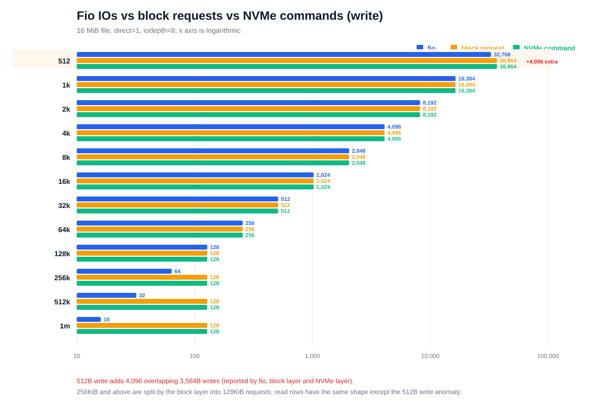
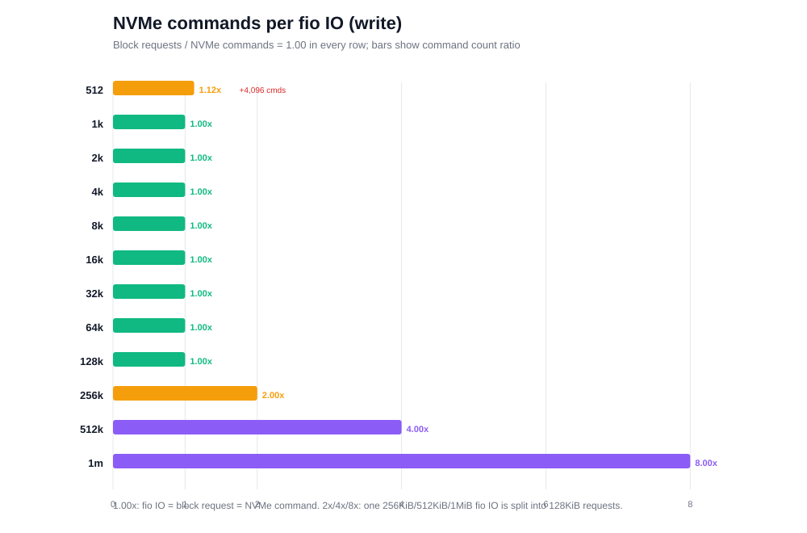
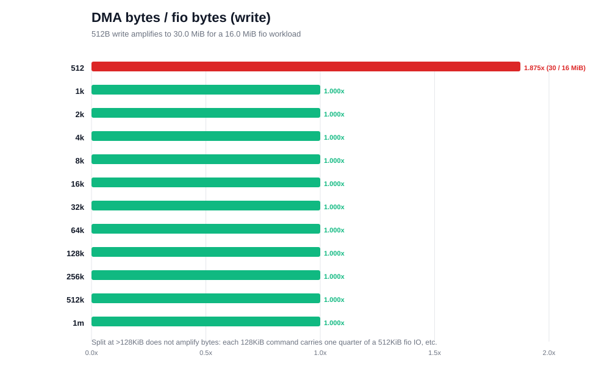
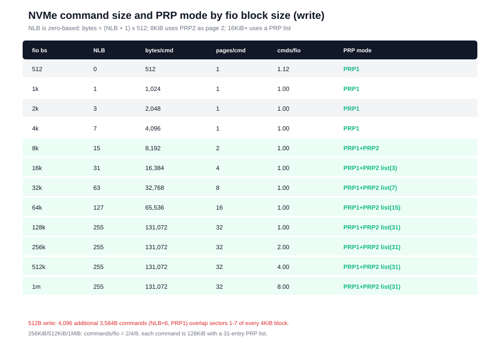
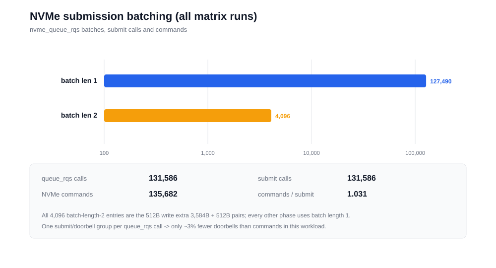
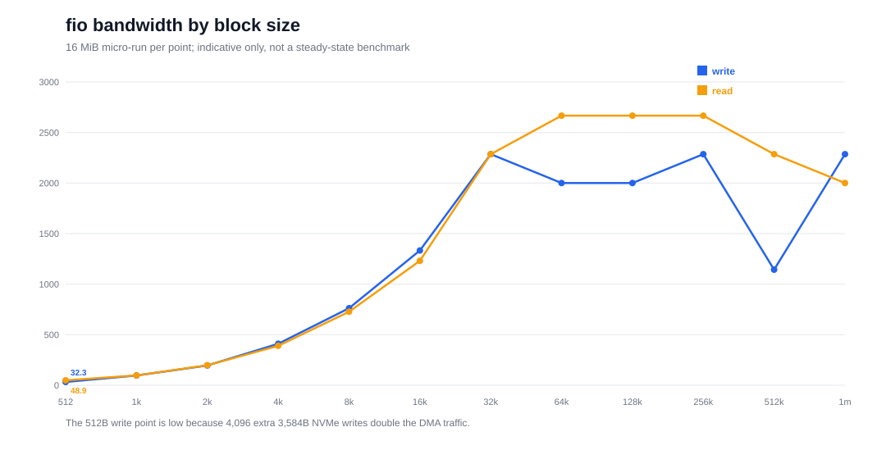

# deep-NVMe-io

Linux 下观测 NVMe over PCIe 的 **IO 发布、DMA 描述符、块层/NVMe 层对账** 的实验脚本和数据。

项目回答三个问题：

1. 从 fio 到 NVMe 设备，各层看到的 IO 数量/大小是什么关系？
2. 不同 block size 下，NVMe 命令的 NLB、PRP list、DMA 传输如何变化？
3. 哪些东西软件层看不到（PCIe TLP），哪些东西可以还原（SQE/CQE、admin、batch、PRP）？

## 结论摘要

- `block_rq_issue` 与 `nvme_setup_cmd`（`qid>=1`，读/写数据命令）在本次所有 block size 下都是 **1:1**。
- `fio IO` 与块层/NVMe **不总是 1:1**：
  - 512B **写**：fio 32,768 条，但块层/NVMe 是 36,864 条命令（多出 4,096 条 3,584B 写），DMA 字节放大到 1.875×。512B 读是干净的 1:1。
  - 1KiB–128KiB：fio、block request、NVMe 命令完全 1:1。
  - 256KiB/512KiB/1MiB：块层按 128KiB 拆成 2/4/8 条 request，NVMe 命令数等于 request 数。
- `nvme_queue_rqs` 在本负载下几乎都是 batch 长度 1；只有 512B 写的 4,096 个“3,584B+512B”配对是长度 2。submit/doorbell 次数只比命令数少约 3%。
- admin 走 `qid=0`，块层没有对应 bio；fio 测试期间 admin 数为 0。单独抓 `nvme id-ctrl/smart-log/get-feature` 可以看到 4KiB/512B/0B 的 admin DMA。
- PCIe TLP（tag、split/merge、ACK/NAK、MPS 分段）软件层看不到；需要 PCIe 分析仪或 QEMU 模拟环境。

## 测试环境

| 项 | 值 |
|---|---|
| 内核 | Linux 7.0.0-43-generic |
| fio | 3.36 |
| bpftrace | 0.20.2 |
| 设备 | Silicon Motion `PCIe-8 SSD 512GB` |
| 链路 | PCIe 3.0 x4，8GT/s，MaxPayload 256B，MaxReadReq 512B |
| IOMMU | on，25 groups；NVMe 在 group 14 |
| 队列限制 | `max_sectors_kb=128`，`max_segments=33`，logical block 512B，scheduler none |
| NVMe | MDTS=6（256KiB），MSI-X 16 vectors |
| 测试方式 | fio 文件 IO，`direct=1`，`iodepth=8`，每档 16MiB；不写裸盘 |

## 结果

### 1. 各层 IO 数量



| fio bs | fio IO 写/读 | block request 写/读 | NVMe 命令 写/读 | NVMe/fio 写/读 | NLB | PRP |
|---|---:|---:|---:|---:|---:|---|
| 512 | 32,768 / 32,768 | 36,864 / 32,768 | 36,864 / 32,768 | 1.12 / 1.00 | 0（额外 6） | PRP1 |
| 1k | 16,384 / 16,384 | 16,384 / 16,384 | 16,384 / 16,384 | 1.00 | 1 | PRP1 |
| 2k | 8,192 / 8,192 | 8,192 / 8,192 | 8,192 / 8,192 | 1.00 | 3 | PRP1 |
| 4k | 4,096 / 4,096 | 4,096 / 4,096 | 4,096 / 4,096 | 1.00 | 7 | PRP1 |
| 8k | 2,048 / 2,048 | 2,048 / 2,048 | 2,048 / 2,048 | 1.00 | 15 | PRP1+PRP2 |
| 16k | 1,024 / 1,024 | 1,024 / 1,024 | 1,024 / 1,024 | 1.00 | 31 | PRP1+list(3) |
| 32k | 512 / 512 | 512 / 512 | 512 / 512 | 1.00 | 63 | PRP1+list(7) |
| 64k | 256 / 256 | 256 / 256 | 256 / 256 | 1.00 | 127 | PRP1+list(15) |
| 128k | 128 / 128 | 128 / 128 | 128 / 128 | 1.00 | 255 | PRP1+list(31) |
| 256k | 64 / 64 | 128 / 128 | 128 / 128 | 2.00 | 255 | PRP1+list(31) |
| 512k | 32 / 32 | 128 / 128 | 128 / 128 | 4.00 | 255 | PRP1+list(31) |
| 1m | 16 / 16 | 128 / 128 | 128 / 128 | 8.00 | 255 | PRP1+list(31) |

- 表中是 **单阶段 16MiB** 的数据；2k/128k 写各有 1–2 条后台 jbd2/kworker 命令，未计入。
- 所有行都满足 `block request == NVMe 命令`；差异只出现在 fio 与块层/NVMe 之间。
- 256KiB 以上没有 256KiB NVMe 命令：块层的 `max_sectors_kb/max_segments` 比 NVMe MDTS 更严格。

### 2. 每条 fio IO 对应多少 NVMe 命令



- 1.00×：fio IO、block request、NVMe 命令一一对应。
- 2/4/8×：fio 的 256KiB/512KiB/1MiB IO 被块层拆成 128KiB request，NVMe 命令数等于 request 数。
- 512B 写是 1.12×：多出的 4,096 条 3,584B 写来自文件系统/子块路径，块层和 NVMe 都能看到。

### 3. DMA 字节放大



512B 写：

```
fio bytes    = 16.0 MiB
NVMe DMA     = 32,768 * 512 + 4,096 * 3,584 = 30.0 MiB
amplification= 1.875x
```

这 4,096 条 3,584B 写落在每个 4KiB 块的 sector 1..7，与 512B 写重叠。它更像是 ext4 对小于 4KiB 直接写的 sub-block 处理，而不是 NVMe 层的重复提交；建议用 XFS 或裸 namespace 再验证一次。512B 读没有这个问题。

### 4. NLB / PRP / DMA 描述符



- NLB 是 0-based，数据字节 = `(NLB+1) * 512`。
- 512B–4KiB：只用 PRP1，一页。
- 8KiB：PRP1 + PRP2，两页。
- 16KiB+：PRP1 + PRP2（PRP list）；16KiB 4 页/list 3 项，128KiB 32 页/list 31 项。
- 256KiB+：每条 NVMe 命令是 128KiB，一条 fio IO 对应 2/4/8 条命令。
- IOMMU 开着时 PRP1/PRP2 是 IOVA，不是物理地址；PRP list 内容未做 IOMMU 翻译，因此不知道 32 页是否物理连续。

### 5. batch / doorbell



```
nvme_queue_rqs calls : 131,586
NVMe commands        : 135,682
batch length 1       : 127,490
batch length 2       :   4,096
batch length > 2     :       0
submit calls         : 131,586
commands / submit    :   1.031
```

- 一个 `queue_rqs` 调用对应一次 submit/doorbell 组；本负载下几乎没有 batch 收益。
- 4,096 个长度 2 的 batch 全部来自 512B 写的额外 3,584B + 512B 配对。

### 6. admin

单独抓 `nvme id-ctrl`、`nvme smart-log`、`nvme get-feature`：

| admin 命令 | 数据字节 | status |
|---|---:|---|
| `nvme_admin_identify` (CNS=1) | 4096 | 0x0 |
| `nvme_admin_get_log_page` | 512 | 0x0 |
| `nvme_admin_get_features` | 0 | 0x0 |

- `qid=0`，块层显示为 `block_rq_issue: 0,0 N <bytes>`，但没有 `block_bio_queue`。
- fio 矩阵运行期间 `qid=0` 计数为 0；admin 不计入数据 IO 分布。

### 7. 吞吐（16MiB micro-run，仅示意）



512B 写只有 32.3MiB/s，主要是因为额外的 3,584B 写把 DMA 量放大到 1.875×；这不是稳态性能测试。

## 仓库结构

```
scripts/
  nvme_capture.sh      # 单次 4K 文件测试 + block/NVMe trace + 64B SQE 采样
  sqe.bt               # 上面的 bpftrace 程序
  bs_matrix.sh         # 512B..1MiB 矩阵 + admin + batch 统计
  bs_matrix.bt         # 矩阵的 bpftrace 程序
analysis/
  analyze_matrix.py    # 矩阵 trace -> matrix/batch/sqe/admin summary
  decode_sqe.py        # nvme_sqe.log 的 64B SQE -> CSV
  make_charts.py       # summary -> SVG 图表
  drgn_nvme.py         # live kernel：队列、in-flight request、SQE/PRP/bio page
data/
  matrix_summary.*     # 当前运行的分层对账结果
  batch_summary.csv
  sqe_samples.csv
  sqe_full_4k.csv
  admin_summary.csv
  manifest.txt
  fio/                 # 24 个 fio JSON
  device/              # 队列限制、identify、lspci、运行元数据
samples/               # 少量 trace / SQE / BPF 片段，便于对照格式
charts/                # README 里的 SVG
docs/
  methodology.md       # 采集点、SQE 布局、对账规则、DMA/PRP
  reproduction.md      # 依赖、命令、输出、排错
  drgn.md              # drgn 依赖、debug info、用法、PRP/IOMMU 限制
```

## 使用

### 环境

- Linux + root + tracefs。
- `fio`、`bpftrace`、`nvme-cli`、`lspci`、`python3`。
- 在一个 **NVMe 上的普通文件** 上测试；不要指向裸盘。脚本会创建测试文件，运行后请手动删除。

### 单次 4K 抓取（512MiB 文件）

```bash
LAB=/path/on/nvme/nvme-lab
mkdir -p "$LAB"

sudo WORK="$LAB" OUT="$LAB/capture" FIO_SIZE=512M \
  ./scripts/nvme_capture.sh
```

输出：

```
capture/trace.txt          # block_bio_queue / block_rq_issue / nvme_setup_cmd / nvme_complete_rq
capture/nvme_sqe.log       # 采样 64B SQE + DATA 行（前 64B payload）
capture/fio_write.json
capture/fio_read.json
capture/nvme_id_ctrl.txt, lspci_nvme.txt, ...
```

### block-size 矩阵

```bash
sudo WORK="$LAB" OUT="$LAB/matrix" SIZE=16M \
  ./scripts/bs_matrix.sh
```

可选：

```bash
BS_LIST="512 1k 2k 4k 8k 16k 32k 64k 128k 256k 512k 1m"
NVME_DEV=/dev/nvme0 NVME_NS=/dev/nvme0n1 PCI_BDF=04:00.0
```

### 分析

```bash
python3 analysis/analyze_matrix.py --capture "$LAB/matrix" --out "$LAB/matrix/summary"
python3 analysis/make_charts.py --data "$LAB/matrix/summary" --out "$LAB/matrix/charts"

python3 analysis/decode_sqe.py --log "$LAB/capture/nvme_sqe.log" \
  --out "$LAB/capture/sqe_full_4k.csv"
```

### drgn：真实内核队列/PRP 快照

drgn 读 live kernel 内存，能看到 tracefs 看不到的 SQE 原始字段、PRP 值、`struct page` 和 in-flight request；PRP list 需要合适的 `--iova-mode`（见下）：

```bash
python3 -m venv .venv
.venv/bin/pip install -r analysis/requirements-drgn.txt

sudo .venv/bin/python analysis/drgn_nvme.py --list
sudo .venv/bin/python analysis/drgn_nvme.py --queues --limit 16 --raw-sqe
sudo .venv/bin/python analysis/drgn_nvme.py --requests --limit 8
sudo .venv/bin/python analysis/drgn_nvme.py --all --json > /tmp/nvme-state.json
```

- 需要 root 和匹配的 vmlinux + nvme/nvme_core **DWARF** 调试信息；BTF 不够。
- 默认 `--iova-mode none`，只打印 PRP，不 dereference；IOMMU 开启时 `--iova-mode direct` 通常是错的。
- 详细安装、输出格式和 IOMMU 限制见 [docs/drgn.md](docs/drgn.md)。

`analyze_matrix.py` 输出：

- `matrix_summary.csv/json`：每档 bs/op 的 fio/block/NVMe 数量、NLB、PRP、DMA 字节、放大比。
- `batch_summary.csv`：全局和每阶段的 batch 长度、submit 次数。
- `sqe_samples.csv`：BPF 采样的 SQE 字段，按 manifest 时间区间归到阶段。
- `admin_summary.csv`：qid 0 admin 命令、数据字节、status。

详细采集点、SQE 字段和对账规则见 [docs/methodology.md](docs/methodology.md)；完整复现步骤和排错见 [docs/reproduction.md](docs/reproduction.md)。

## 分析要点

1. **先对 block request 和 NVMe 命令，不要先对 fio。** `block_rq_issue` 已经过 merge/split；它和 `nvme_setup_cmd(qid>=1)` 才应该是 1:1。
2. **字节对账。** block request 字节总和应等于 NVMe `(NLB+1)*512` 总和（排除 flush/discard/admin）。
3. **LBA 对账。** 1:1 时 `block sector + 分区起始 sector == NVMe SLBA`。
4. **qid 过滤。** `qid=0` 是 admin，不是 fio 数据；单独统计。
5. **512B 的额外 3,584B 写** 在块层和 NVMe 层都能看到，属于文件系统/子块路径；不要把它当成 NVMe 重复提交，换 XFS/裸盘验证。
6. **>128KiB 是块层拆分的正常结果**：request 数 = NVMe 命令数，fio IO 数是它们的 1/2、1/4、1/8。
7. **DMA 只能看到描述符。** PRP1/PRP2、NLB、数据方向可以还原；TLP 级顺序、tag、ACK/NAK 不可见。

## 限制

- **PCIe TLP 不可见。** 需要 PCIe 协议分析仪/硬件 tap，或在 QEMU 模拟 NVMe 中观察 MMIO/DMA。
- **IOMMU 开启。** PRP1/PRP2 是 IOVA；没有做 IOMMU 页表翻译，所以没有证明 PRP 指向的物理页。
- **PRP list 内容未读。** 只知道 PRP2 是 list 指针，不知道 32 个页是否连续。
- **trace 可能丢事件。** 检查每个 trace 头部的 `entries-in-buffer/entries-written` 和 `OVERRUN`；矩阵脚本用 32MiB/CPU buffer，16MiB 单档未丢。
- **结论有环境边界。** 单设备、单内核、`scheduler=none`、`direct=1`、QD8；不同 merge 策略、文件系统、IOMMU、PCIe 拓扑都会改变结果。
- **原始 trace 未提交。** 体积约 120MiB；用脚本重新生成。仓库只保留 summary、图表和少量样本。

## License

未指定；如需引用请先联系仓库作者。
